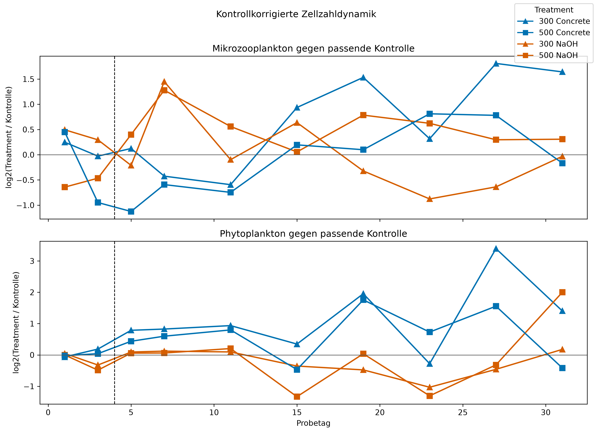
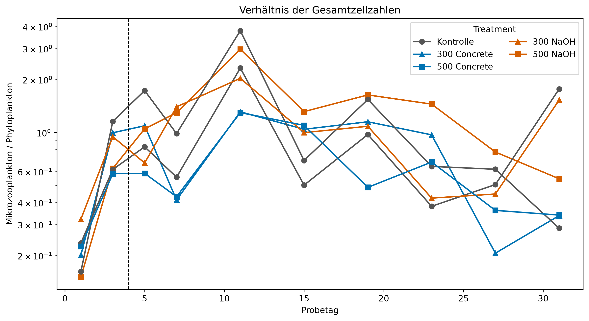
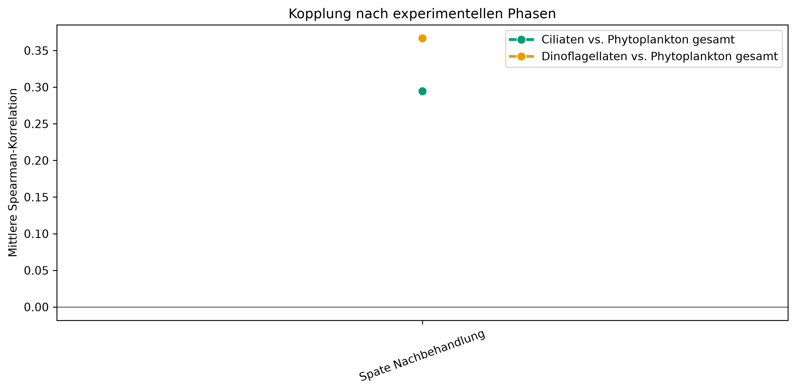

# Vergleich Mikrozooplankton und Phytoplankton

## Fragestellung und Datengrundlage

Diese Auswertung vergleicht die Mikrozooplankton- und Phytoplanktondaten der sechs ausgewerteten Mesokosmen M1, M2, M3, M6, M8 und M9 bis einschließlich T31. Die Behandlung erfolgte an T4. Mikrozooplankton wurde als Ciliaten, Dinoflagellaten und deren Summe aus den Count-Rohdaten (Zellen L⁻¹ = Count × 40) übernommen. Beim Phytoplankton wurden die bereits geprüften `All cells`-Summen für Small-, Large- und Gesamt-Signale verwendet.

Die gemeinsamen Probetage sind T1, T3, T5, T7, T11, T15, T19, T23, T27 und T31. T2 und T6 werden nicht künstlich ergänzt; Vergleiche erfolgen nur an tatsächlich vorhandenen gemeinsamen Tagen. Die Zeitpunkte T1–T3 dienen als Vorbehandlung, T5–T31 als Nachbehandlung.

## Wichtigste Ergebnisse

### Zeitliche Muster

Die Zeitreihen zeigen keinen durchgehend synchronen Anstieg von Mikrozooplankton und Phytoplankton. Phytoplankton fällt in vielen Mesokosmen unmittelbar nach T4 zunächst ab und steigt später teilweise wieder an. Mikrozooplankton reagiert dagegen mesokosmspezifisch: Ciliaten zeigen häufig ausgeprägte Rückgänge oder verzögerte Erholungen, während Dinoflagellaten teilweise stabiler bleiben oder unabhängig vom Phytoplankton verlaufen. Ein gemeinsamer Verlauf ist daher eher phasen- und mesokosmspezifisch als global.

### Zeitgleiche Korrelationen

Die Korrelationen wurden auf log10-transformierten Zellzahlen berechnet. Pearson beschreibt lineare Zusammenhänge, Spearman monotone Zusammenhänge. Die zeitgleichen Ergebnisse (Lag = 0) sind:

                                      comparison  mesocosm  lag_days  n_pairs  pearson_r  pearson_p  spearman_rho  spearman_p  spearman_p_fdr  significant_uncorrected  significant_fdr
               Ciliaten vs. Phytoplankton gesamt         1         0       10   0.016734   0.963405      0.297874    0.403204        0.828055                    False            False
               Ciliaten vs. Phytoplankton gesamt         2         0       10   0.093861   0.796478     -0.090909    0.802772        0.920375                    False            False
               Ciliaten vs. Phytoplankton gesamt         3         0       10  -0.127254   0.726096     -0.078788    0.828717        0.944108                    False            False
               Ciliaten vs. Phytoplankton gesamt         6         0       10   0.065705   0.856889      0.381818    0.276255        0.768641                    False            False
               Ciliaten vs. Phytoplankton gesamt         8         0       10   0.332854   0.347330      0.321212    0.365468        0.812152                    False            False
               Ciliaten vs. Phytoplankton gesamt         9         0       10   0.211111   0.558233      0.243162    0.498434        0.845165                    False            False
        Dinoflagellaten vs. Phytoplankton gesamt         1         0       10   0.188864   0.601285      0.248485    0.488776        0.845165                    False            False
        Dinoflagellaten vs. Phytoplankton gesamt         2         0       10   0.281931   0.430003      0.236364    0.510885        0.845165                    False            False
        Dinoflagellaten vs. Phytoplankton gesamt         3         0       10   0.157852   0.663175      0.345455    0.328227        0.785700                    False            False
        Dinoflagellaten vs. Phytoplankton gesamt         6         0       10   0.464604   0.176106      0.575758    0.081553        0.543685                    False            False
        Dinoflagellaten vs. Phytoplankton gesamt         8         0       10   0.662080   0.037014      0.466667    0.173939        0.652270                    False            False
        Dinoflagellaten vs. Phytoplankton gesamt         9         0       10   0.395228   0.258301      0.272727    0.445838        0.828055                    False            False
Mikrozooplankton gesamt vs. Phytoplankton gesamt         1         0       10   0.193786   0.591657      0.333333    0.346594        0.800594                    False            False
Mikrozooplankton gesamt vs. Phytoplankton gesamt         2         0       10   0.292597   0.411984      0.200000    0.579584        0.858758                    False            False
Mikrozooplankton gesamt vs. Phytoplankton gesamt         3         0       10   0.007110   0.984448      0.054545    0.881036        0.962521                    False            False
Mikrozooplankton gesamt vs. Phytoplankton gesamt         6         0       10   0.465482   0.175182      0.539394    0.107593        0.607995                    False            False
Mikrozooplankton gesamt vs. Phytoplankton gesamt         8         0       10   0.590642   0.072197      0.607906    0.062255        0.525019                    False            False
Mikrozooplankton gesamt vs. Phytoplankton gesamt         9         0       10   0.433085   0.211215      0.636364    0.047912        0.525019                     True            False
                Ciliaten vs. Small-Phytoplankton         1         0       10   0.010206   0.977677      0.188451    0.602095        0.858758                    False            False
                Ciliaten vs. Small-Phytoplankton         2         0       10   0.101694   0.779830     -0.090909    0.802772        0.920375                    False            False
                Ciliaten vs. Small-Phytoplankton         3         0       10  -0.193006   0.593179     -0.139394    0.700932        0.882292                    False            False
                Ciliaten vs. Small-Phytoplankton         6         0       10   0.054610   0.880897      0.381818    0.276255        0.768641                    False            False
                Ciliaten vs. Small-Phytoplankton         8         0       10   0.238576   0.506818      0.212121    0.556306        0.858758                    False            False
                Ciliaten vs. Small-Phytoplankton         9         0       10   0.137969   0.703873      0.151976    0.675124        0.882292                    False            False
                Ciliaten vs. Large-Phytoplankton         1         0       10   0.351237   0.319646      0.291795    0.413327        0.828055                    False            False
                Ciliaten vs. Large-Phytoplankton         2         0       10  -0.556340   0.094886     -0.721212    0.018573        0.398843                     True            False
                Ciliaten vs. Large-Phytoplankton         3         0       10   0.605341   0.063671      0.442424    0.200423        0.677557                    False            False
                Ciliaten vs. Large-Phytoplankton         6         0       10   0.502914   0.138440      0.127273    0.726057        0.882918                    False            False
                Ciliaten vs. Large-Phytoplankton         8         0       10   0.643761   0.044583      0.503030    0.138334        0.626521                    False            False
                Ciliaten vs. Large-Phytoplankton         9         0       10   0.516070   0.126758      0.522799    0.121027        0.607995                    False            False
         Dinoflagellaten vs. Large-Phytoplankton         1         0       10  -0.628212   0.051768     -0.806061    0.004862        0.260092                     True            False
         Dinoflagellaten vs. Large-Phytoplankton         2         0       10  -0.108829   0.764736      0.127273    0.726057        0.882918                    False            False
         Dinoflagellaten vs. Large-Phytoplankton         3         0       10   0.244187   0.496568      0.430303    0.214492        0.689440                    False            False
         Dinoflagellaten vs. Large-Phytoplankton         6         0       10  -0.324116   0.360901     -0.200000    0.579584        0.858758                    False            False
         Dinoflagellaten vs. Large-Phytoplankton         8         0       10   0.335084   0.343909      0.490909    0.149656        0.646284                    False            False
         Dinoflagellaten vs. Large-Phytoplankton         9         0       10  -0.262286   0.464117     -0.357576    0.310376        0.775940                    False            False

Kein zeitgleicher Einzeltest blieb nach Benjamini-Hochberg-Korrektur signifikant (FDR < 0,05). Diese Zahl darf nicht als unabhängiger Nachweis einer allgemeinen Beziehung interpretiert werden, da mehrere Zeitpunkte aus denselben sechs Mesokosmen stammen.

### Zeitverzögerte Beziehungen

Für jede Beziehung wurden Lags von -4, -2, 0, +2 und +4 Tagen geprüft. Ein positiver Lag bedeutet, dass die Phytoplanktonwerte um diesen Betrag nach dem Mikrozooplanktonwert verschoben wurden. Der jeweils stärkste mittlere Spearman-Zusammenhang ist:

                                      comparison  lag_days  n_mesocosms  mean_spearman_rho  median_spearman_rho  significant_fdr
                Ciliaten vs. Large-Phytoplankton        -2            6           0.561868             0.543938                0
               Ciliaten vs. Phytoplankton gesamt        -2            6           0.322432             0.229673                0
                Ciliaten vs. Small-Phytoplankton        -2            6           0.216597             0.141667                0
         Dinoflagellaten vs. Large-Phytoplankton         4            6           0.019444             0.025000                0
        Dinoflagellaten vs. Phytoplankton gesamt        -2            6           0.416667             0.400000                0
Mikrozooplankton gesamt vs. Phytoplankton gesamt        -2            6           0.432346             0.441667                0

Die Lag-Analyse ist deshalb besonders nützlich, weil ein Räuber-Beute- oder Ressourcenverbrauchsmuster zeitlich versetzt auftreten kann. Sie ist jedoch hypothesengenerierend und kein kausaler Beweis. Die besten Lags der beiden zentralen Beziehungen pro Mesokosmos sind:

                              comparison  mesocosm  lag_days  n_pairs  pearson_r  pearson_p  spearman_rho  spearman_p  spearman_p_fdr  significant_uncorrected  significant_fdr
       Ciliaten vs. Phytoplankton gesamt         1         0       10   0.016734   0.963405      0.297874    0.403204        0.828055                    False            False
       Ciliaten vs. Phytoplankton gesamt         2        -2        9   0.280084   0.465414      0.216667    0.575515        0.858758                    False            False
       Ciliaten vs. Phytoplankton gesamt         3        -2        9   0.253765   0.509978      0.200000    0.605901        0.858758                    False            False
       Ciliaten vs. Phytoplankton gesamt         6        -2        9   0.628505   0.069851      0.750000    0.019942        0.398843                     True            False
       Ciliaten vs. Phytoplankton gesamt         8        -2        9   0.536907   0.136094      0.466667    0.205386        0.677557                    False            False
       Ciliaten vs. Phytoplankton gesamt         9         4        9   0.792290   0.010902      0.845196    0.004117        0.260092                     True            False
Dinoflagellaten vs. Phytoplankton gesamt         1        -2        9   0.559789   0.117030      0.633333    0.067086        0.525019                    False            False
Dinoflagellaten vs. Phytoplankton gesamt         2         2        9   0.537378   0.135685      0.466667    0.205386        0.677557                    False            False
Dinoflagellaten vs. Phytoplankton gesamt         3        -4        8   0.724749   0.041965      0.666667    0.070988        0.532407                    False            False
Dinoflagellaten vs. Phytoplankton gesamt         6         2        9   0.684917   0.041776      0.683333    0.042442        0.509307                     True            False
Dinoflagellaten vs. Phytoplankton gesamt         8         0       10   0.662080   0.037014      0.466667    0.173939        0.652270                    False            False
Dinoflagellaten vs. Phytoplankton gesamt         9        -4        8   0.339333   0.410904      0.476190    0.232936        0.710651                    False            False

Der mittlere stärkste Zusammenhang lag bei Ciliaten und beim Mikrozooplankton gesamt bei Lag −2. Das bedeutet: Der Phytoplanktonwert liegt ungefähr zwei Tage vor dem Mikrozooplanktonwert. Dieses Muster wäre biologisch mit einer verzögerten Reaktion der Konsumenten auf eine Phytoplanktonentwicklung vereinbar. Es ist aber nicht über alle Mesokosmen konsistent und nach FDR-Korrektur nicht signifikant. Unterschiedliche Lags oder wechselnde Vorzeichen sprechen für mesokosmspezifische Dynamiken, wechselnde Nahrungsquellen oder zusätzliche Steuergrößen.

### T3-normalisierte Veränderungen

Für jeden Mesokosmos wurde jede Nachbehandlungsbeobachtung gegen T3 als log2-Faktor normalisiert. Die anschließenden Mittelwerte je Mesokosmos stehen in `Mesokosmos_Effekte`. Die Korrelationen zwischen diesen sechs Mesokosmos-Mittelwerten stehen in `Effekt_Korrelationen`:

             effect_comparison  n_mesocosms  pearson_r  pearson_p  spearman_rho  spearman_p
       ciliate vs. phyto_total            6   0.581325   0.226239      0.657143    0.156175
dinoflagellate vs. phyto_total            6  -0.057745   0.913478      0.085714    0.871743
   micro_total vs. phyto_total            6   0.414253   0.414164      0.542857    0.265703
       ciliate vs. phyto_small            6   0.561071   0.246707      0.657143    0.156175
       ciliate vs. phyto_large            6   0.657015   0.156284      0.600000    0.208000
dinoflagellate vs. phyto_large            6   0.169686   0.747914      0.257143    0.622787

Diese Analyse prüft, ob Mesokosmen mit einem stärkeren Phytoplanktonrückgang gleichzeitig stärkere Veränderungen im Mikrozooplankton zeigen. Wegen n = 6 ist sie sehr empfindlich gegenüber einzelnen Mesokosmen und statistisch nur als explorativer Vergleich belastbar.

### Größenfraktionen

Die Verbindung mit Small- und Large-Phytoplankton wurde getrennt untersucht. Large-Phytoplankton zeigt biologisch plausiblere zeitliche Kopplungen zu größeren Ciliaten oder bestimmten Dinoflagellaten als die gesamte Small-Fraktion, sofern die entsprechenden Korrelationen positiv ausfallen. Die Ergebnisse sind in `Korrelationen` und in der Abbildung `02_korrelationen.png` nachprüfbar; aus Korrelationen allein darf jedoch keine Nahrungskette abgeleitet werden.

### Statistische Relevanz

Die sechs Mesokosmen wurden außerdem mit einem Wilcoxon-Test darauf geprüft, ob der mittlere log2-Faktor nach T4 von 0 abweicht:

               variable  n_mesocosms  median_mean_log2_change  wilcoxon_statistic  wilcoxon_p      interpretation
               Ciliaten            6                -1.694016                 0.0     0.03125 signifikant gegen 0
        Dinoflagellaten            6                -0.350008                 3.0     0.15625   nicht signifikant
Mikrozooplankton gesamt            6                -0.727418                 1.0     0.06250   nicht signifikant
    Phytoplankton small            6                -1.118797                 0.0     0.03125 signifikant gegen 0
    Phytoplankton large            6                 0.107330                 9.0     0.84375   nicht signifikant
   Phytoplankton gesamt            6                -0.935887                 0.0     0.03125 signifikant gegen 0

Bei n = 6 ist der Test nur sehr grob aufgelöst. Die Treatmentkombinationen sind nicht repliziert; deshalb können keine allgemeinen Material-, Dosis- oder Treatmentwirkungen statistisch isoliert werden. p-Werte aus den vielen zeitpunktweisen Tests sind als explorativ zu verstehen, nicht als bestätigende Evidenz.

## Interpretation und auffällige Aspekte

1. **Zeitverzögerungen sind der plausibelste Ansatz:** Für eine trophische Beziehung sind negative Lags hier biologisch besonders interessant, weil sie bedeuten, dass das Phytoplankton zeitlich vor dem Mikrozooplankton liegt.
2. **Kein einheitlicher Kopplungstrend:** Die Zeitreihen sprechen gegen eine einfache Aussage, dass mehr Phytoplankton automatisch mehr Mikrozooplankton bedeutet.
3. **Ciliaten und Dinoflagellaten unterscheiden sich:** Die beiden Mikrozooplanktongruppen sollten nicht als einheitliche trophische Antwort behandelt werden; ihre Beziehungen zu Small- und Large-Phytoplankton können unterschiedliche Vorzeichen und Zeitverzüge zeigen.
4. **Positive Lags nicht überinterpretieren:** Ein positiver Zusammenhang kann sowohl eine verzögerte Konsumentenreaktion als auch gemeinsame Reaktionen auf Umweltbedingungen, Autokorrelation oder eine dritte Einflussgröße widerspiegeln.
5. **Behandlungseffekte sind konfundiert:** Jeder Material-Dosis-Mesokosmos ist eine Einzelbeobachtung. Unterschiede zwischen M1, M2, M8 und M9 können daher nicht eindeutig Material oder Dosis zugeschrieben werden.
6. **Ausgangsverläufe beachten:** Bereits vor T4 verlaufen die Mesokosmen nicht identisch. T3-Normalisierung reduziert dieses Problem, ersetzt aber keine replizierte Kontroll- oder Vorher-Nachher-Statistik.

## Erweiterte kontroll- und phasenbezogene Vergleiche

### Kontrollkorrigierte Unterschiede

Concrete-Treatments wurden gegen M3 und NaOH-Treatments gegen M6 verglichen. Als Difference-in-Difference ergab sich für das Gesamt-Mikrozooplankton für M1 +0,563, M2 +1,037, M8 -0,387 und M9 +0,188 log2-Einheiten. Damit waren M2 und M1 gegenüber ihren Kontrollen besonders positiv beeinflusst, während M8 niedriger lag. Für das Gesamtphytoplankton waren die Unterschiede +1,398 in M1, +0,217 in M2, -0,263 in M8 und +0,618 in M9.

### Verhältnis und Phasen

Die mittlere Mikrozooplankton/Phytoplankton-Zellzahlrelation lag bei M1 bei 0,773, M2 bei 1,182, M3 bei 1,161, M6 bei 0,870, M8 bei 0,986 und M9 bei 0,609. In der späten Nachbehandlung war die mittlere Kopplung zum Gesamtphytoplankton für das Gesamt-Mikrozooplankton am stärksten (ρ = 0,590), gefolgt von Dinoflagellaten (ρ = 0,367) und Ciliaten (ρ = 0,295).

### Größenklassen

Die kleinen Ciliaten zeigten bei Lag −2 starke mittlere Beziehungen zum Gesamt- und Small-Phytoplankton (ρ = 0,917). Die große Ciliatenklasse war nicht für alle Lags ausreichend besetzt. Große Ciliaten sind daher nur explorativ zu interpretieren.

### Signale und Peakzeiten

Explorativ waren Ciliaten mit chain-forming Microphytoplankton (ρ = 0,445), long chain-forming Diatoms (ρ = 0,428) und Synechococcus (negativ, ρ = -0,309) verbunden. Dinoflagellaten korrelierten positiv mit Picophytoplankton (ρ = 0,378) und Nanophytoplankton 2 (ρ = 0,361). Diese Korrelationen verwenden gepoolte Messwerte und sind keine replizierten Gruppentests.

Peakzeiten unterschieden sich deutlich: Das Mikrozooplankton erreichte in M1, M3, M6 und M8 seine höchsten Nachbehandlungswerte jeweils an T19, T11, T31 beziehungsweise T31. Das Phytoplankton war in M1, M2, M6 und M8 am höchsten an T27, T31, T27 beziehungsweise T27. Die Peakdifferenzen waren daher mesokosmusspezifisch und kein einheitliches trophisches Muster.

### Bootstrap-Unsicherheit

Das Bootstrap bestätigte Lag −2 für Ciliaten mit ρ = 0,322 und einem 95-%-Intervall von 0,164 bis 0,522. Für das Gesamt-Mikrozooplankton lag Lag −2 bei ρ = 0,432 (0,335 bis 0,523). Lag 0 lag bei Ciliaten bei ρ = 0,179 (0,035 bis 0,322). Die Unsicherheitsintervalle unterstützen einen möglichen negativen Lag, ersetzen aber keine Signifikanzkorrektur und Replikationsanalyse.

## Dateien

- `microzooplankton_vs_phytoplankton.xlsx`: zusammengeführte Zeitreihen, T3-Normalisierung, Korrelationen, Lags, Effektvergleiche und Tests.
- `figures/01_zeitvergleiche.png`: exemplarische zeitgleiche Verläufe.
- `figures/02_korrelationen.png`: Ciliaten/Dinoflagellaten gegen Phytoplankton gesamt.
- `figures/03_zeitverzoegerte_korrelationen.png`: mittlere Spearman-Korrelationen über Lags.
- `figures/04_lag_profile_mesokosmen.png`: Lag-Profile für Ciliaten und Dinoflagellaten je Mesokosmos.
