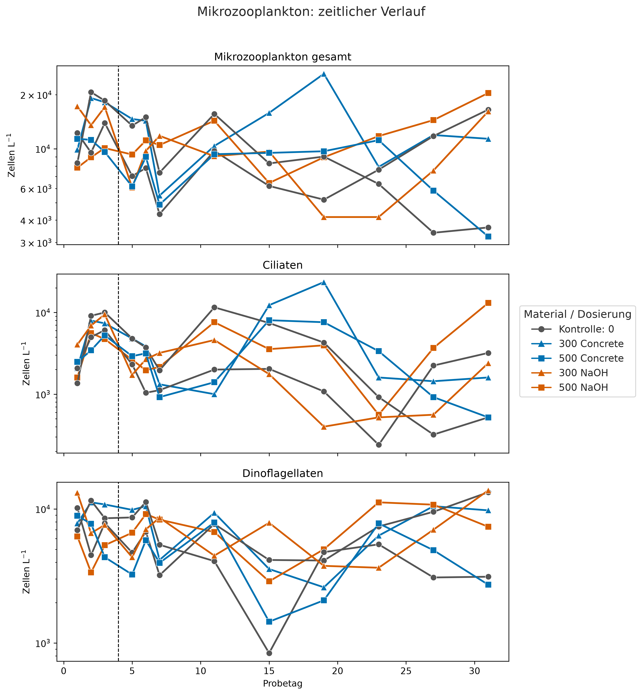
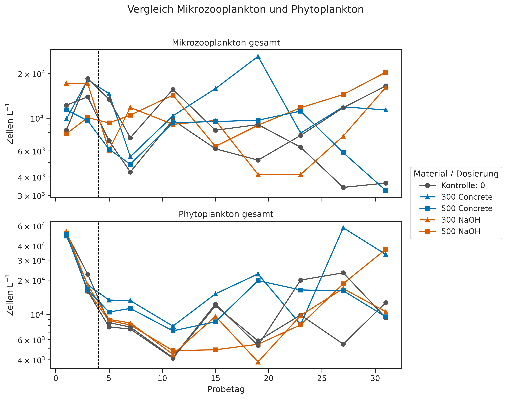
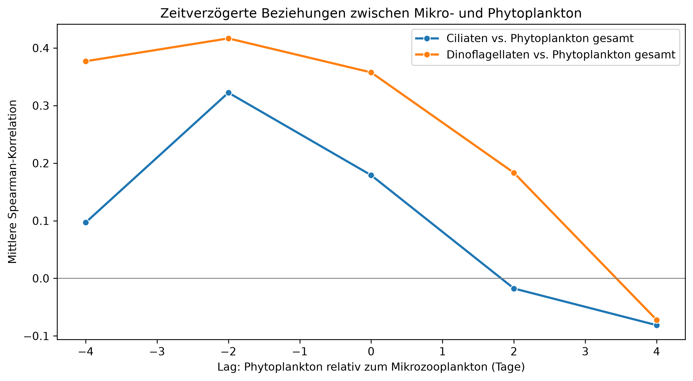
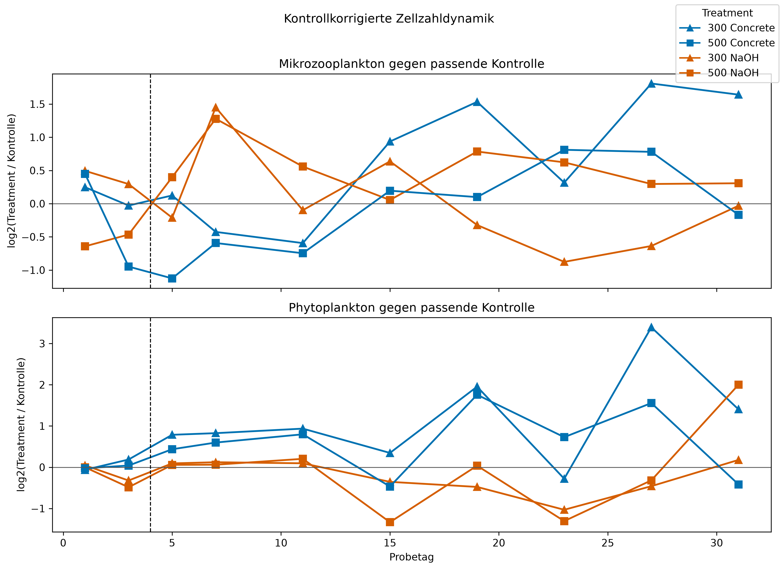
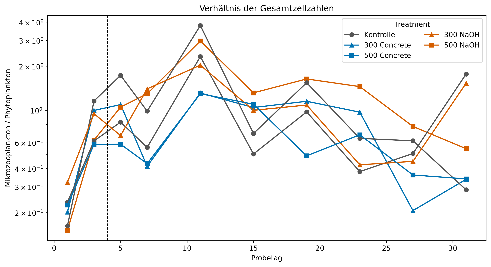
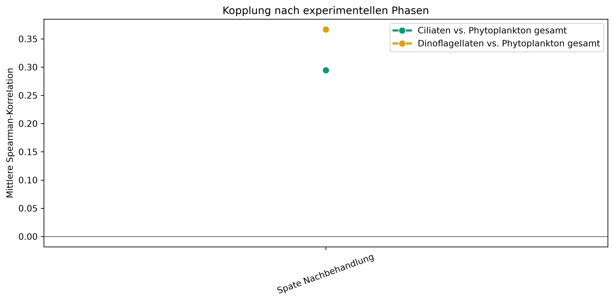
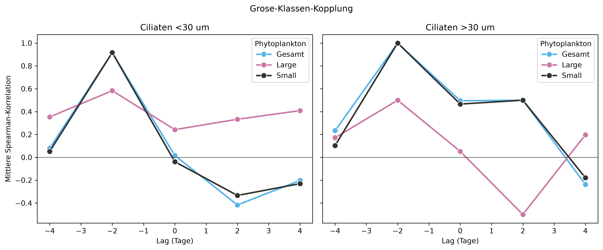

# Berichtsgrafiken: Mikrozooplankton und Phytoplankton

Die folgenden Abbildungen wurden für die direkte Verwendung im Bericht neu gestaltet und verwenden einen konsistenten, kontrastreichen Farb- und Symbolcode.

## Wiederverwendbarer Berichtscode

| Zweck | Kennzeichnung | Farbe / Symbol |
|---|---|---|
| Concrete | Material | Blau `#0072B2` |
| NaOH | Material | Orange `#D55E00` |
| Kontrolle | Dosierung 0 | Grau `#555555`, Kreis |
| Dosierung 300 | Treatment | Dreieck |
| Dosierung 500 | Treatment | Quadrat |
| Mikrozooplankton gesamt | Gruppe | Schwarzgrau `#333333` |
| Ciliaten | Gruppe | Grün `#009E73` |
| Dinoflagellaten | Gruppe | Gelborange `#E69F00` |

Die Coding-Ebene ist kontextabhängig: In Mesokosmos-Zeitreihen kennzeichnet die Farbe das Material und das Symbol die Dosierung. In Abbildungen, die Ciliaten und Dinoflagellaten direkt gegenüberstellen, kennzeichnen die Gruppenfarben die biologische Gruppe. Die gestrichelte vertikale Linie markiert T4, den Behandlungstag. Die y-Achsen der Zellzahlverläufe sind logarithmisch skaliert.

## Abbildung 1: Mikrozooplankton

**Abbildungslegende:** Zeitlicher Verlauf der Gesamtzellzahl des Mikrozooplanktons sowie der Ciliaten und Dinoflagellaten in den sechs ausgewerteten Mesokosmen. Die Farbe zeigt das Material (Concrete blau `#0072B2`, NaOH orange `#D55E00`), das Symbol die Dosierung (0 = Kreis, 300 = Dreieck, 500 = Quadrat). Die gestrichelte Linie markiert die Behandlung an T4.

## Abbildung 2: Vergleich Mikro- und Phytoplankton

**Abbildungslegende:** Vergleich der zeitlichen Entwicklung des Gesamt-Mikrozooplanktons und des Gesamtphytoplanktons. Dargestellt sind nur Messwerte, die für beide Analysen an denselben Probetagen vorliegen.

## Abbildung 3: Zeitverzögerte Beziehungen

**Abbildungslegende:** Mittlere Spearman-Korrelationen zwischen Mikrozooplankton und Phytoplankton bei verschiedenen zeitlichen Verschiebungen. Ciliaten sind grün (`#009E73`) und Dinoflagellaten gelborange (`#E69F00`) dargestellt. Ein negativer Lag bedeutet, dass das Phytoplankton zeitlich vor der Mikrozooplanktongruppe liegt.

## Ergänzende Lag-Abbildung

**Abbildungslegende:** Lag-Profile der einzelnen Mesokosmen für Ciliaten und Dinoflagellaten gegenüber dem Gesamtphytoplankton. Die Abbildung zeigt die mesokosmspezifische Streuung der optimalen zeitlichen Verschiebung.

## Abbildung 4: Kontrollkorrigierte Verläufe

**Abbildungslegende:** Kontrollkorrigierte Entwicklung von Mikro- und Phytoplankton als log2(Treatment/Kontrolle). Concrete-Treatments werden gegen M3 und NaOH-Treatments gegen M6 verglichen.

## Abbildung 5: Mikrozooplankton-Phytoplankton-Verhältnis

**Abbildungslegende:** Verhältnis der Gesamtzellzahlen von Mikrozooplankton und Phytoplankton über alle gemeinsamen Probetage.

## Abbildung 6: Phasenvergleich

**Abbildungslegende:** Mittlere Spearman-Korrelationen für Ciliaten und Dinoflagellaten gegenüber dem Gesamtphytoplankton nach experimenteller Phase.

## Abbildung 7: Lag-Muster nach Größenklassen

**Abbildungslegende:** Explorative Lag-Korrelationen kleiner und großer Ciliaten gegenüber Small-, Large- und Gesamtphytoplankton.
