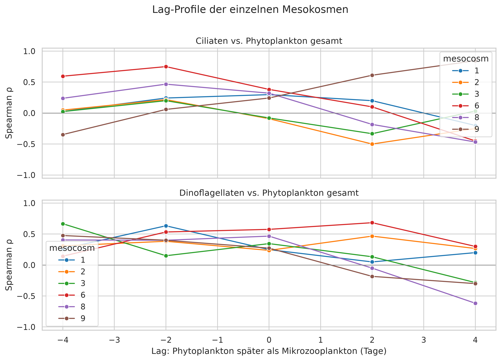

# Berichtsgrafiken: Mikrozooplankton und Phytoplankton

Die folgenden Abbildungen wurden für die direkte Verwendung im Bericht erstellt. Alle Abbildungen verwenden dieselbe Codierung:

- **Farbe = Material:** Concrete blau (`#0072B2`), NaOH orange (`#D55E00`)
- **Symbol = Dosierung:** 0 = Kreis, 300 = Dreieck, 500 = Quadrat
- Die gestrichelte vertikale Linie markiert T4, den Behandlungstag.
- Die y-Achsen sind logarithmisch skaliert, da die Zellzahlen mehrere Größenordnungen umfassen.

## Abbildung 1: Mikrozooplankton

**Abbildungslegende:** Zeitlicher Verlauf der Gesamtzellzahl des Mikrozooplanktons sowie der Ciliaten und Dinoflagellaten in den sechs ausgewerteten Mesokosmen. Die Farbe zeigt das Material, das Symbol die Dosierung. Die gestrichelte Linie markiert die Behandlung an T4.

## Abbildung 2: Vergleich Mikro- und Phytoplankton

**Abbildungslegende:** Vergleich der zeitlichen Entwicklung des Gesamt-Mikrozooplanktons und des Gesamtphytoplanktons. Dargestellt sind nur Messwerte, die für beide Analysen an denselben Probetagen vorliegen.

## Abbildung 3: Zeitverzögerte Beziehungen

**Abbildungslegende:** Mittlere Spearman-Korrelationen zwischen Mikrozooplankton und Phytoplankton bei verschiedenen zeitlichen Verschiebungen. Ein negativer Lag bedeutet, dass das Phytoplankton zeitlich vor dem Mikrozooplankton liegt.

## Ergänzende Lag-Abbildung

**Abbildungslegende:** Lag-Profile der einzelnen Mesokosmen für Ciliaten und Dinoflagellaten gegenüber dem Gesamtphytoplankton. Die Abbildung zeigt die mesokosmspezifische Streuung der optimalen zeitlichen Verschiebung.
